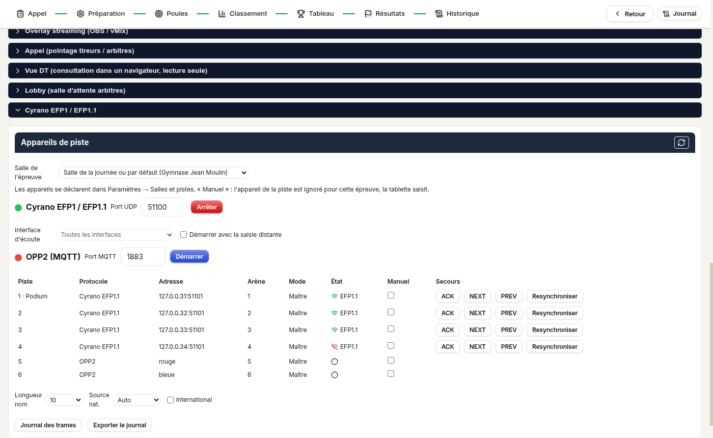
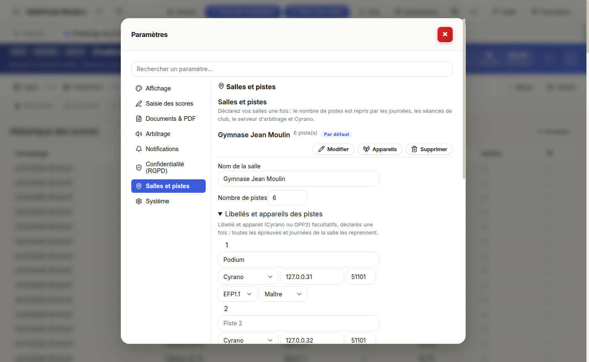
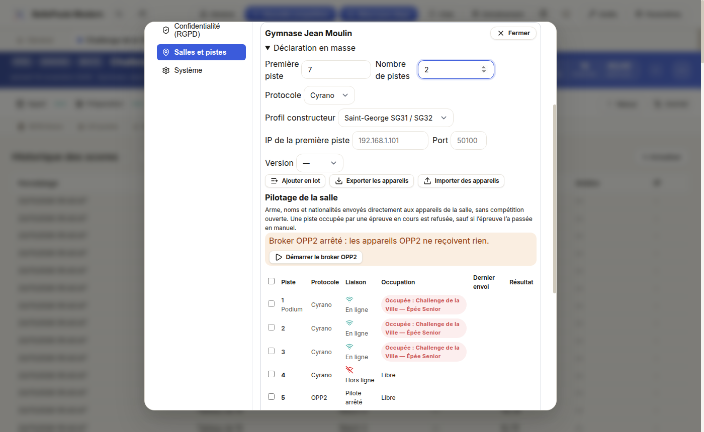
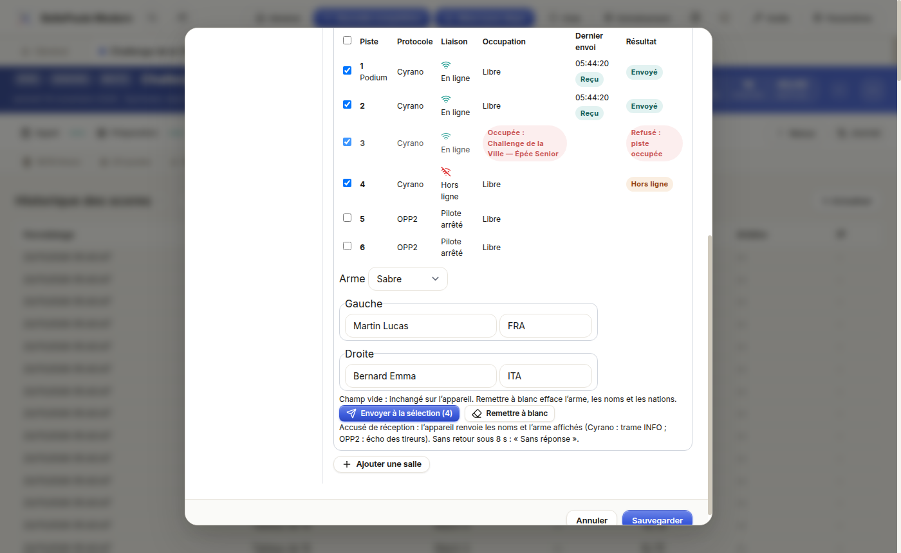

# Captures d'écran

Aperçu des principaux écrans et menus de BPM - Escrime, sur une compétition de démonstration (épée senior, 18 tireurs, 3 poules, tableau de 32), une journée à deux épreuves et un club de démonstration.

> Captures générées automatiquement : `npm run build && npm run docs:screenshots` (sous Linux sans écran : `xvfb-run -a npm run docs:screenshots`). Script : [`scripts/capture-screenshots.js`](../scripts/capture-screenshots.js).

## Sommaire

1. [Accueil](#accueil)
2. [Nouvelle compétition](#nouvelle-compétition)
3. [Liste des compétitions](#liste-des-compétitions)
4. [Appel (pointage)](#appel-pointage)
5. [Préparation des poules](#préparation-des-poules)
6. [Poules](#poules)
7. [Classement après poules](#classement-après-poules)
8. [Tableau](#tableau)
9. [Résultats](#résultats)
10. [Saisie distante](#saisie-distante)
11. [Historique des scores](#historique-des-scores)
12. [Menu Actions de la compétition](#menu-actions-de-la-compétition)
13. [Menu Outils](#menu-outils)
14. [Paramètres](#paramètres)
15. [Mode Entraînement](#mode-entraînement)
16. [Palette de commandes](#palette-de-commandes)
17. [Appareils de piste (saisie distante)](#appareils-de-piste-saisie-distante)
18. [Tableau de bord analytique](#tableau-de-bord-analytique)
19. [Salles et pistes](#salles-et-pistes)
20. [Paramètres Système (agent IA, sauvegardes)](#paramètres-système-agent-ia-sauvegardes)
21. [Journée multi-épreuves](#journée-multi-épreuves)
22. [Mode Club : membres](#mode-club--membres)
23. [Mode Club : séance](#mode-club--séance)
24. [Mode Club : statistiques](#mode-club--statistiques)
25. [Appareils d'une salle (déclaration en masse)](#appareils-dune-salle-déclaration-en-masse)
26. [Pilotage de la salle](#pilotage-de-la-salle)

## Accueil

Premier lancement : étapes clés, **Nouvelle compétition** ou **Ouvrir…** un fichier existant.

## Nouvelle compétition

Titre, date, arme, genre, catégorie, lieu ; case **Compétition par équipes**.

## Liste des compétitions

Onglet **Général** : une carte par compétition (arme, catégorie, lieu, nombre de tireurs), export `.bpm`.

## Appel (pointage)

Phase **Appel** : liste des tireurs, pointage individuel ou **Tout pointer**, import / export, colonnes configurables.

## Préparation des poules

Phase **Préparation** : nombre de poules, taille, critères de séparation (club, région, nation), glisser-déposer entre poules.

## Poules

Phase **Poules** : feuilles de poule avec saisie des scores, impression, export PDF, arbitres.

## Classement après poules

Phase **Classement** : V, M, V/M, TD, TR, indice ; export CSV / PDF ; **Passer au tableau**.

## Tableau

Phase **Tableau** : élimination directe, petite finale, vues tableau / pyramide, menu **Options**.

## Résultats

Phase **Résultats** : podium et classement final.

## Saisie distante

Bouton **Saisie distante / Piste** du bandeau de la compétition : serveur démarré, volets **Basique** / **Expert**, pistes (intervalle, plan, mots de passe), kiosque, thème global, écrans connectés. Voir [REMOTE_SCORE_GUIDE.md](../REMOTE_SCORE_GUIDE.md).

## Historique des scores

Phase **Historique** : journal horodaté de chaque modification de score, filtres, export CSV / JSON.

## Menu Actions de la compétition

Bouton **⋯** de l'en-tête : comparaisons, analytics, partage, kiosque public, export, propriétés.

## Menu Outils

Barre supérieure : **QR Code WiFi** ([WIFI_QR_GUIDE.md](WIFI_QR_GUIDE.md)), **Télécommande TV** ([TELECOMMANDE_TV.md](TELECOMMANDE_TV.md)).

## Paramètres

Sections Affichage (langue, thème, taille du texte, densité), Saisie des scores, Documents & PDF, Arbitrage, Notifications, Confidentialité (RGPD), Salles et pistes, Système ; recherche dans les paramètres.

## Mode Entraînement

Arme, nombre de pistes, durée du combat, interface réseau.

## Palette de commandes

`Ctrl+K` : recherche de compétitions et d'actions, navigation entre phases (`Ctrl+1…8`). Voir [COMMANDES.md](COMMANDES.md).

## Appareils de piste (saisie distante)

Saisie distante, bloc **Pistes**, dès qu'un pilote tourne : salle de l'épreuve, appareils Cyrano et OPP2 des pistes de l'épreuve (lecture seule), liaison de chaque piste, case **Manuel** qui passe une piste en saisie sur tablette pour cette épreuve, secours. Pilotes et journal des trames : Paramètres → Salles et pistes. Voir [CYRANO.md](CYRANO.md).

## Tableau de bord analytique

Menu **⋯** → **Analytics** : performances, statistiques, graphiques, organisation (retards), arbitres, journal ; **Rapport PDF** post-tournoi.

## Salles et pistes

Paramètres → **Salles et pistes** : salles du poste et leurs pistes, réutilisées par les journées, les arènes et les appareils de piste. Chaque piste déclare son appareil une fois (Cyrano : adresse, port, version ; OPP2 : identifiant MQTT ; mode), repris par toutes les épreuves de la salle ([ADR-0023](adr/0023-appareils-de-piste-salle.md)).

## Paramètres Système (agent IA, sauvegardes)

Paramètres → **Système** : canal de mise à jour, proxy, **Agent IA (MCP)** local et désactivé par défaut ([MCP.md](MCP.md)), dossier des sauvegardes, export / import des paramètres.

## Journée multi-épreuves

Accueil → **Journées** : épreuves d'une même salle regroupées, pistes de la salle, arbitres saisis une fois et reportés selon leur arme. Voir [JOURNEE_MULTI_EPREUVES.md](JOURNEE_MULTI_EPREUVES.md).

## Mode Club : membres

Bouton **Club** : espace permanent du club, membres (cartes à code, photo webcam, import / export), maîtres d'armes, séances, statistiques, exercices, inventaire. Voir [MODE_CLUB.md](MODE_CLUB.md).

## Mode Club : séance

Séance ouverte : scan des cartes, pointage, plan de cours, saisie distante des combats libres, pistes.

## Mode Club : statistiques

Classement du club par période et par catégorie d'âge, à partir des combats des séances.

## Appareils d'une salle (déclaration en masse)

Salles et pistes → bouton **Appareils** d'une salle → **Déclaration en masse** : ajout en lot (première piste, nombre, protocole, profil constructeur, IP de la première piste incrémentée, port, version), export et import JSON des appareils de la salle. Voir [CYRANO.md](CYRANO.md#pilotage-de-la-salle-hors-compétition-2117).

## Pilotage de la salle

Même panneau, **Pilotage de la salle**, sans compétition ouverte : grille des pistes (protocole, liaison, épreuve qui occupe la piste, dernier envoi et accusé), sélection de plusieurs pistes, envoi en une fois de l'arme, des noms et des nations, remise à blanc. Résultat par piste : envoyé puis **Reçu** quand l'appareil renvoie l'affichage, refusé si la piste est occupée par une épreuve en cours, hors ligne. Voir [CYRANO.md](CYRANO.md#pilotage-de-la-salle-hors-compétition-2117).

